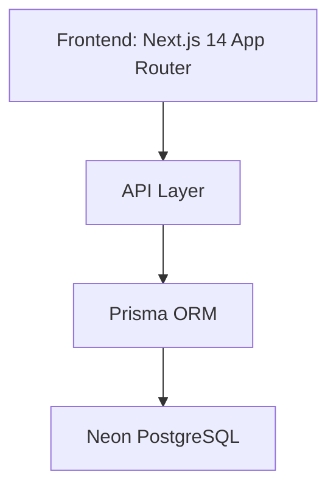

# JSTU Cafeteria and Billing System

A full-stack cafeteria management system for JSTU.

### System Architecture

### Tech Stack
- **Frontend:** Next.js 14, TypeScript, Tailwind CSS
- **Backend:** Next.js API Routes
- **Database:** Neon PostgreSQL + Prisma ORM
- **Deployment:** Vercel

### Real Wallet Logic
- User wallet check & deduct in atomic DB transaction
- Prevents negative balance

---

### Developed and Designed By
**Arnica Tabassum**
Department of CSE
Jamalpur Science and Technology University

**GitHub:** [tabassumarnica1100-portfolio](https://github.com/tabassumarnica1100-portfolio)
**Project Link:** [JSTU Cafeteria and Billing System](https://github.com/tabassumarnica1100-portfolio/Jstu-cafeteria-and-billing-system)